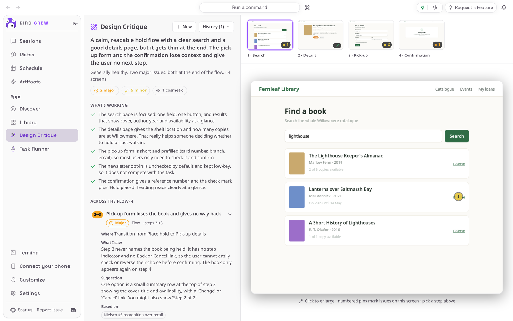

# Design Critique

<picture>
  <source media="(prefers-color-scheme: dark)" srcset="docs/media/hero-dark.png">
  
</picture>

**A design review you can run before you ask a colleague: what works, what to tighten, and why.**

Design Critique is an app for [Kiro Crew](https://github.com/kirodotdev/KiroCrew),
the open-source personal AI agent.

## What it is

Design Critique adds a **Design Critique** page to Kiro Crew. Give it one
screenshot or the screens of a whole flow, in order, and it reads them the way an
experienced designer would: an overall read, what is working, and the things worth
tightening. Each finding has a severity, says where it is and what was seen, and
names the rule behind it. Numbered pins mark the spot on the screen. For a flow it
also looks at the jumps between screens. You can select any line of the report
and ask a question about it.

**Get started:** Design Critique already comes with Kiro Crew, switched off. Open
**Apps → Library**, choose **Show N disabled apps**, then on the **Design
Critique** tile open the **⋯** menu and choose **Enable**. [Install](#install) has
the details.

## The problem it solves

You have a screen or a sign-up flow that is nearly done, and you want a second
pair of eyes before you show it around. A colleague's time is scarce, and a
general chat assistant tends to give vague praise or guess at things it cannot
see.

Design Critique works only from what it can actually see. It reads the pictures
you give it, ties every finding to a place on a screen and to a named rule
(Nielsen's heuristics, WCAG, Gestalt, Fitts's law), and rates it on the NN/g
severity scale. When something cannot be judged from the pictures, such as an
exact contrast ratio, it says so instead of guessing. It never changes your
design: it only reports.

## Top 3 use cases

### 1. Get a quick read on one screen

You have finished a pick-up form and want to know what to fix first. Drop the
screenshot into the page and choose **Critique this screen**. In about half a
minute you get the overall read, what is working, and the findings ranked by
severity. Choose a finding to open it; its pin is on the screen beside it.


### 2. Check a whole flow for the gaps between screens

Some problems only show up across screens: a button that changes its name, a step
with no way back, an ending that leads nowhere. Add the screens of the flow in
order and choose **Critique this flow**. Besides the per-screen findings, the
report has an **Across the flow** section, and the strip of screens at the top
lets you switch between them. Here the critic noticed that the pick-up form on
step 3 no longer says which book is being held: the title only comes back on the
confirmation.


### 3. Ask about one line of the report

A finding is not clear, or you want to know why it matters. Select a few words of
the report with the mouse, choose **Ask about this**, and type your question. The
answer appears in place, and you can keep asking follow-ups. Your questions stay
with that critique in your history.


## Watch it


[Watch the walkthrough as a video (MP4)](docs/media/walkthrough.mp4).

<sub>Recorded from a real Kiro Crew dashboard on a throwaway home, running this
repository's own copy of the app (commit `d481b0a`), installed from a clone. The
Kiro Crew was the App Kit level-1 commit `99161724c0` with only its built-in copy
of this app removed, because a Kiro Crew that ships it refuses a second
install. The screens it critiques are
made-up mockups of a fictional library app, written for this README. Every report
and the follow-up answer come from a live AI model and will vary from run to run:
the light and dark pictures at the top are two separate critiques of the same
screens. The wait while the critique runs (about 45 seconds) is shortened in the
video.</sub>

## Install

**Today: Design Critique comes with Kiro Crew.** Nothing needs downloading. It
starts switched off:

1. In Kiro Crew, open **Apps → Library** in the left sidebar.
2. Choose **Show N disabled apps** (N is how many apps are switched off).
3. On the **Design Critique** tile, open the **⋯** menu and choose **Enable**.
4. **Design Critique** now appears under **Apps** in the sidebar.

**Coming soon: from the Kiro Crew App Store.** Once this app is listed there:

1. Open **Apps → Discover** in the left sidebar.
2. Search for **Design Critique** and choose **Install**.
3. Kiro Crew asks **Trust “Design Critique” to run its own code?** Design
   Critique uses a small program of its own to copy a repository, find its
   screens and take pictures of them. Trusting it gives that program the same
   access Kiro Crew has (your files, your saved sign-ins and the internet), as
   the dialog says. If you are happy with that, choose **Trust this app**. You can
   take it back later in **Settings → Security → Third-party apps**.
4. The app installs switched off. Choose **Enable** on its page.

What you need: Kiro Crew on a Mac, Linux or Windows computer, and Kiro Crew must
already be able to chat (if ordinary chats work, the critic works). For
screenshots, nothing else. To have it take its own pictures of a folder, a
repository or a running site, the computer also needs Node.js; the first time,
it downloads a headless browser once into a cache in your home folder. A private
GitHub repository needs you to have signed in with `gh auth login`.

## First run

Open **Design Critique** from the sidebar. The left panel says **No critiques
yet**; the right asks **What should I critique?** with a box to drop screenshots
into, and a field for a link or a folder. **See an example** shows a finished
critique of a sample checkout flow, so you can see what you will get before
giving it anything of your own.


## How to use it

1. **Add your screens.** Drop screenshots on **Drop screenshots — or click to
   browse**, or click it to choose files. Any image file is taken; PNG, JPG and
   WebP work best, because other formats (a HEIC photo, for example) are sent to
   the model as they are, without converting them. For a flow,
   add them in the order a person goes through them; use the arrows under each
   one to reorder, and **Add screens** to add more. Up to 20 screens.
2. **Or point it at something.** Instead of screenshots, paste a Figma link, a
   GitHub/GitLab/Bitbucket repository, a folder on this computer, or the address
   of a site that is already running, and choose **Critique**. For a folder or a
   repository it lists the screens it found under **What should I audit?**; tick
   the ones to look at, optionally say who it is for, and start. For Figma it asks
   you to export the frames as PNGs and drop those in instead.
3. **Start it.** Choose **Critique this screen** (one) or **Critique this flow**
   (several). The page shows its progress. You can leave the page; the critique
   keeps running and is waiting for you when you come back.
4. **Read the report.** The left panel has the overall read, the counts by
   severity, **What's working**, then the findings. Choose a finding to open it:
   **Where**, **What I saw**, the suggestion, and **Based on** (the rules). For a
   flow, the strip at the top switches screens; choose a screen to enlarge it.
5. **Ask about anything.** Select words in the report, choose **Ask about this**,
   and type a question. Choose **New** to start another critique; **History**
   reopens earlier ones.

## Settings & data

- **Where your data lives:** your screenshots are uploaded into Kiro Crew's
  uploads folder, `~/.kiro/crew/uploads/` (under `$KIROCREW_HOME` if you set it),
  like any file you attach to a chat. Pictures the app takes itself are saved
  there too (in `dc-render-…` folders), so your saved critiques keep their images.
  Copies of repositories (`dc-clones/`) and trial pictures (`dc-probe-…`) are
  deleted after an hour.
- **Your critique history** (the reports and your questions) is kept in this
  browser, not on the server, and the critique chats are hidden from your chat
  list.
- **What leaves your computer:** the screenshots and the critique prompt go to the
  same AI model as the rest of your Kiro Crew. When you give it a repository or a
  site, it fetches that repository or page itself; addresses inside your own
  network are refused, except a site on this computer (`localhost`).
- **What it never does:** it does not install a project's dependencies, run its
  scripts, start its dev server or change its files. It refuses folders that hold
  credentials, such as `~/.ssh`.
- **Who can use it:** only the person who set up this Kiro Crew can start a
  critique of a folder, a repository or a site.
- **Turn it off:** **Apps → Library**, open the **⋯** menu on Design Critique,
  choose **Disable**.
- **Remove it** (once it is installed from the App Store): the same menu,
  **Uninstall**. The copy that comes with Kiro Crew can be switched off but not
  removed.

## Troubleshooting / FAQ

**"Those weren't image files."**
None of the files you dropped was an image (a PDF or a document, for example).
Save the screen as a picture, preferably PNG, JPG or WebP, and drop it in again.

**"That's more than 20 screens — send fewer."**
One critique reads at most 20 screens. Split a long flow into parts.

**"That critique didn't finish."**
The run stopped before a report came back. Look at the plug icon at the top right
of Kiro Crew: green means Kiro Crew is running. Check that ordinary chats work,
then start the critique again.

**It says it could not see some screens.**
The **Couldn't see** list names the screens it could not get a picture of, for
example pages behind a sign-in. Drop screenshots of those screens instead.

**My Figma link was not critiqued.**
Export the frames you want as PNGs from Figma and drop them in as screenshots;
that runs the same critique.

**"That path is protected and can't be read."**
That folder holds credentials or Kiro Crew's own settings, so the app refuses to
read it. Pick the project folder itself.

**"that URL can't be reviewed".**
Only `http` and `https` addresses on the public internet, or a site on this
computer typed as `localhost`, can be reviewed.

**"owner authorization required" when critiquing a folder, repository or site.**
You are using a Kiro Crew that someone else set up and shared with you. Only they
can start that kind of critique; screenshots still work.

## Development

This repository is the externally packaged form of the `design-critique` app that
ships built into Kiro Crew. The two share a name and the same permissions, and
this copy's version is never below the built-in's, so the Kiro Crew release that
adds built-in adoption can move an existing built-in install onto this source in
place, at a commit pinned in that release. Until a user's Kiro Crew does that, it
keeps running its built-in copy, and nothing here changes what they run. Fixes
that land on the built-in are carried here too, with a patch version bump.
[PORTING.md](PORTING.md) lists every place this copy differs from the built-in,
the fixes carried since the port, and why.

| Path | What it is |
|---|---|
| `app.json` | The app manifest, including the `ui` entry and the `l10n` listing copy |
| `backend/routes.py` | In-gateway route hooks (`backend.hooks.routes`): `/method`, `/discover`, `/render` and their job polls |
| `backend/_host.py` | Everything the backend takes from the gateway: the App Kit seams, and the pinned table of gateway functions that have no seam yet |
| `skills/design-critique/` | The critique method (`SKILL.md`, `frameworks/main-checklist.md`) and the Node capture scripts |
| `ui/src/` | The dashboard page (React), built against `@kirocrew/app-sdk` |
| `ui/i18n/` | The page's strings in every language the dashboard ships |
| `ui/samples/` | The example flow **See an example** shows |
| `ui/dist/index.mjs` | The built page, **committed**: an install is a plain clone with no build step |
| `ui/tests/` | UI tests (vitest + jsdom), with light stand-ins for the host SDK |
| `assets/` | Store icon, hero art and screenshot (raster, as the catalog requires) |
| `tests/` | Backend, skill-script and manifest tests, runnable offline with pytest |
| `capture/` | Captures the README media from a real, isolated Kiro Crew ([capture/README.md](capture/README.md)) |
| `docs/media/` | The README pictures and walkthrough, plus `media.json` (sizes, alt text, commits) |

### What it needs from Kiro Crew

Kiro Crew 0.13.0 or later (`minKiroCrewVersion`), for App Kit level 1: an owner
gate for an app's hooks (`ctx.require_owner`), the seam level (`ctx.sdk_level`)
and route records the app defines itself. These seams are not in Kiro Crew 0.12.0,
whose route registry skips this app's routes, so on 0.12.0 every route answers 404
and folder, repository and site critiques cannot start; Kiro Crew refuses to
install the app there. The seams come with Kiro Crew pull request
[#27517](https://github.com/kirodotdev/KiroCrew/pull/27517), which is still open:
this app needs the first release that includes it. No backend module imports
`kiro_crew`. The app also uses a few gateway functions that
have no App Kit seam yet: the sandbox every `git` and `node` child runs in, the
public-address rule, the credential-path check and the data home.
`backend/_host.py` resolves those by name, each with a stand-in that refuses, and
`tests/test_no_host_imports.py` pins the list. When one is missing the app
reports degraded health and screenshots still work, but the other modes refuse,
each in its own way:

- no sandbox or no data home: discover and render answer 503 `host_unsupported`
  before touching a file;
- no public-address rule: every repository and site address is refused with
  "that URL can't be reviewed", except a site on this computer typed as
  `localhost`;
- no credential-path check: every folder is refused with "that path is
  protected";
- no trusted `git` resolver: a repository cannot be copied.

### Install from a clone

```bash
git clone https://github.com/KiroCrewCaptain/kirocrew-app-design-critique
kirocrew app install ./kirocrew-app-design-critique
```

Then turn it on from **Apps → Library**. The app runs its own code
(`backend.hooks` in `app.json`), so Kiro Crew will not enable it until you trust
it: the Library's **Enable** opens **Trust “Design Critique” to run its own
code?**, and **Trust this app and enable** does both. Until it is trusted,
`kirocrew app enable design-critique` is refused with `app_execution_denied`.

While your Kiro Crew still has the built-in copy installed, the install itself is
refused: `app 'design-critique' is already installed`. From a terminal,
`kirocrew app disable design-critique` turns the app off, and
`kirocrew app uninstall design-critique` removes an installed copy.

### Routes

The routes are served under `/api/apps/design-critique/` while the app is enabled:
`GET /method` (the checklist the page inlines into its prompt), `POST /discover`
and `POST /render` (start a detached job and return its id), and
`GET /discover?job=` / `GET /render?job=` (poll it). The two POSTs ask the host's
owner gate first unless the caller holds an app token the gateway already confined
to this app's `permissions.api`.

### Tests

Backend, skill scripts and manifest:

```bash
python -m pip install -r tests/requirements.txt
python -m flake8 backend tests capture
python -m pytest
```

These need neither Kiro Crew nor the network. `tests/conftest.py` blocks any
installed `kiro_crew`, and `tests/host_double.py` stands in for the gateway
functions; `tests/test_host_stand_ins.py` runs without it, to pin that every
stand-in refuses. The skill-script tests run the scripts under `node` and skip
when it is missing.

`tests/test_manifest_host_parser.py` checks `app.json` with Kiro Crew's own
manifest parser, from a Kiro Crew checkout you name; without one it is skipped.
CI's `host-parser` job runs it against a pinned Kiro Crew commit:

```bash
python -m pip install -r tests/requirements-host.txt
KIROCREW_SRC=/path/to/KiroCrew python -m pytest tests/test_manifest_host_parser.py
```

UI (Node 24, from `ui/`):

```bash
npm ci
npm run typecheck
npm test
npm run build
```

`npm run build` writes `ui/dist/index.mjs`. Commit it with the source change that
produced it: CI rebuilds it from a clean `npm ci` and fails if the result differs.
The bundle imports only modules the dashboard provides (React, the JSX runtime,
`lucide-react`, `@kirocrew/app-sdk` and `@kirocrew/app-sdk/ui`), and from the SDK
only names every supported host exports.

### Re-capture the README media

The pictures and the recording come from a real, isolated Kiro Crew gateway
driven by [`capture/`](capture/README.md). The critiques are live, so they need
an installed, signed-in `kiro-cli`:

```bash
python capture/capture.py --kirocrew /path/to/KiroCrew
python capture/check_readme.py
```

Then look at every image and at a few frames of the video, and update the alt
text and this README to say what the new critiques say (see
[CHECKLIST.md](CHECKLIST.md)).

## License

Apache License 2.0. See [LICENSE](LICENSE) and [NOTICE](NOTICE).
